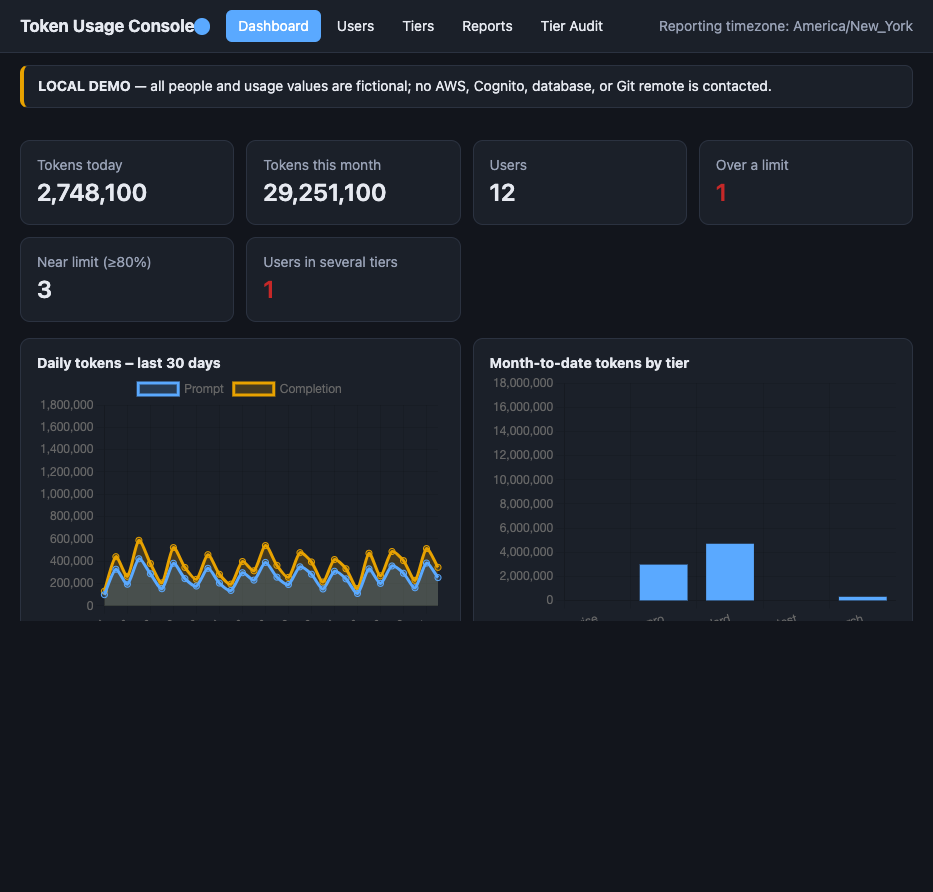
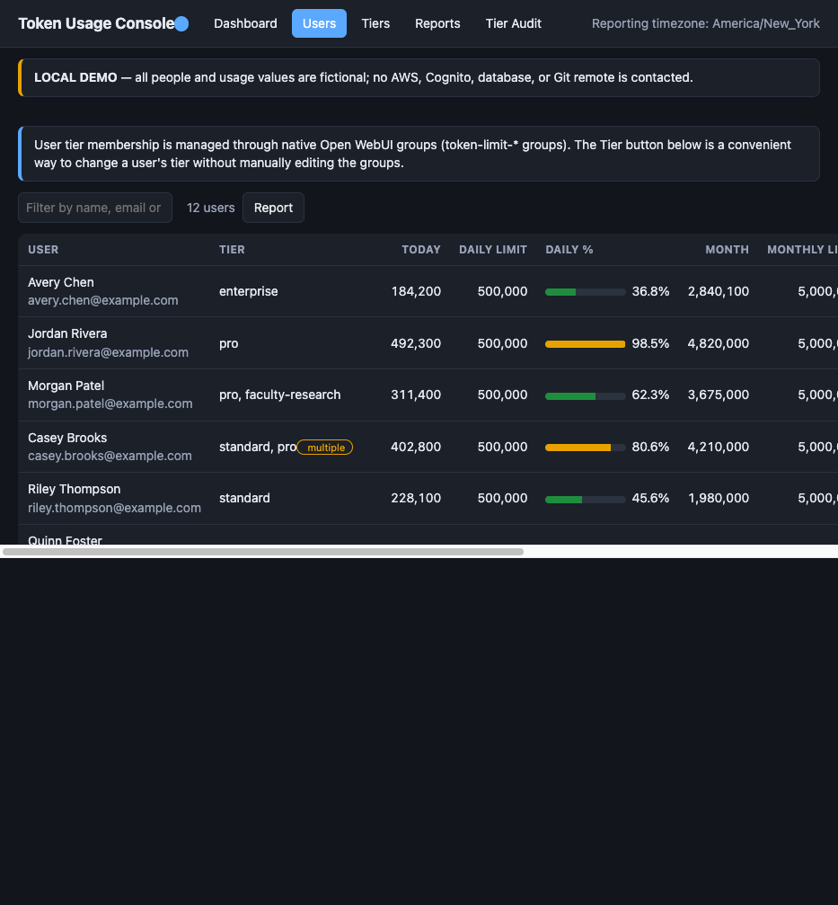
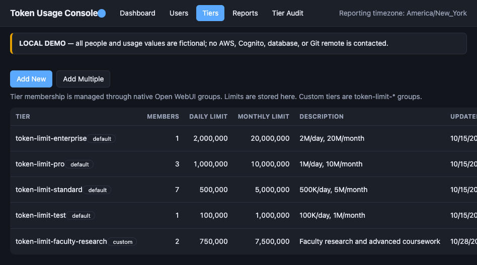
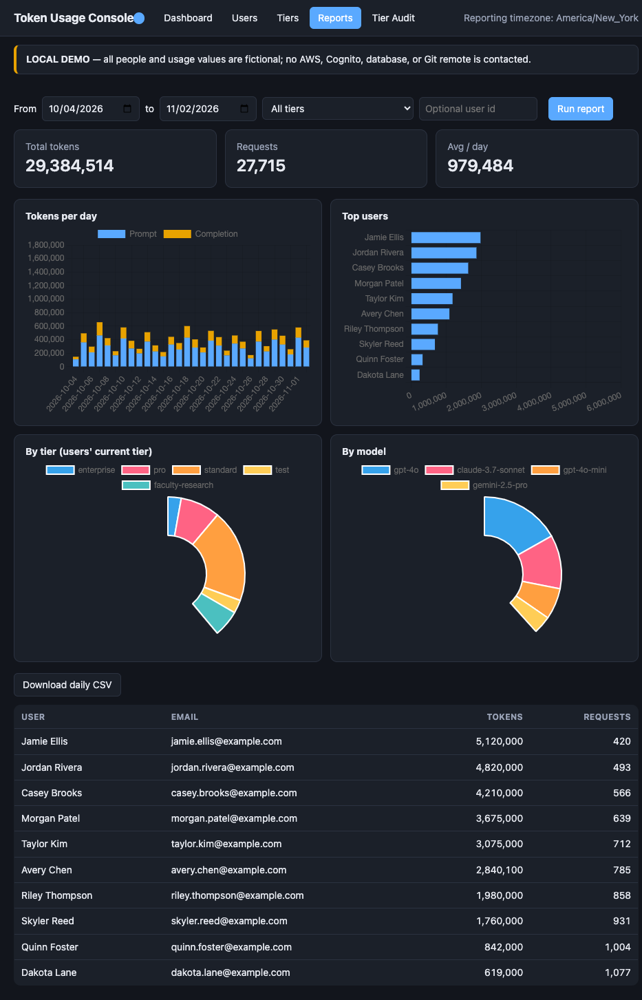
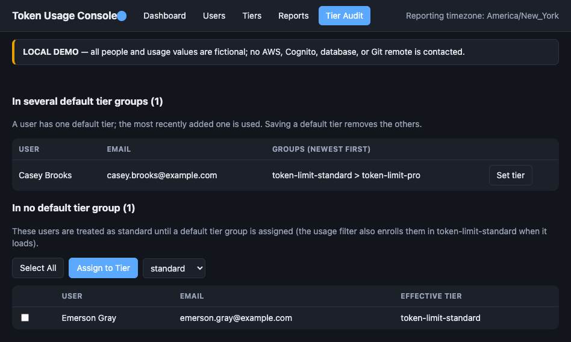

# owui-token-usage-management-console

Developed by Nathan I Keiter, Gettysburg College.

A secure, admin-only web console for managing and reporting [Open WebUI](https://github.com/open-webui/open-webui) token usage. It is the graphical (GUI)
version of the [owui-token-usage-admin](https://github.com/nkeiter/owui-token-usage-admin) CLI and works on the same database objects created by the
required [owui-token-usage-tracking-plugin](https://github.com/nkeiter/owui-token-usage-tracking-plugin) usage tracking filter (v1.2.0+).

It runs as a single AWS Lambda function (`owui-token-usage-management-console`) behind an API Gateway HTTP API.
It does not modify Open WebUI itself.

## Configuration

### Create your `config.json`

All deployment settings live in a single JSON file in the project root. A template with
placeholder values, [`config.example.json`](config.example.json), is provided.

1. Copy the template to `config.json` in the project root (same folder as `deploy.sh`):

   ```bash
   cp config.example.json config.json
   ```

2. Open `config.json` and replace every placeholder value (`vpc-0000...`, `your-dev-database-secret`,
   `example.com` URLs, and so on) with the values for your own AWS account and Open WebUI deployment. The
   [Configuration reference](#configuration-reference) explains each key. The `dev` and `prod` sections are
   independent; fill in only the environment you plan to deploy first.
3. Never put database passwords or DSNs in `config.json`. Store them in AWS Secrets Manager and reference the
   secret by name (`secret_id`) and JSON key (`secret_dsn_key`).
4. Treat `config.json` as deployment-specific: it contains account, network, and host identifiers. Do not share
   it or publish it to a public repository.

**Recommended tooling.** Use [Visual Studio Code](https://code.visualstudio.com/) with the
[AWS Toolkit extension](https://marketplace.visualstudio.com/items?itemName=AmazonWebServices.aws-toolkit-vscode)
to browse your AWS account (VPCs, subnets, security groups, Secrets Manager secrets, ACM certificates) and find
the IDs and names the config needs. You can also use **GitHub Copilot** in VS Code to help populate `config.json`:
describe your environment (for example, "find the private subnets and the PostgreSQL security group for the
VPC that hosts Open WebUI") and have it explain each setting, then verify every value against the AWS console or
CLI before deploying.

**Friendly URL (optional).** Amazon provides a default access URL for the deployed site
(`https://<api-id>.execute-api.<region>.amazonaws.com/`, shown as the `ConsoleUrl` stack output), so no DNS
changes are required to use the console. If you want a user-friendly hostname, set `custom_domain_name` and
`certificate_arn` and **update your organization's DNS settings** (certificate-validation CNAME and a traffic
CNAME to the site). See [Custom domains](#custom-domains).

The JSON config contains AWS region, VPC/subnet/security-group IDs, Secrets
Manager secret names (not secret contents), Open WebUI URLs, optional custom
domains/certificate ARNs, the tracking-filter source path, and usage-filter
settings. Database credentials must remain in AWS Secrets Manager. The selected
secret must contain the DSN under `secret_dsn_key`.

The `usage_*` settings must match the installed Open WebUI usage tracking
filter: `usage_timezone`, `usage_tier_prefix`, `usage_builtin_tiers` (in
tie-break order), `usage_default_tier`, and the default daily/monthly token
limits. The script injects these settings into Lambda; the browser reads the
same tier and timezone settings from `/config.json`.

`deploy.sh` reads the config selected by `CONFIG_FILE` (default `config.json`).
Supported config keys and environment-variable overrides are listed in the
deployment section below.

## Features

- **Dashboard**: tokens today / this month, users over or near a limit, users with conflicting default tiers, daily token
  chart (last 30 days), month-to-date usage by tier.
- **Users**: all Open WebUI users with tier, usage, limits and percentages (the count reads `N users`, or
  `shown/total users` while a search or tier filter is active; the **View Users** button on the Tiers page opens
  this tab filtered to that tier); each row has a **Report** button and the toolbar **Report** button opens Reports for the users currently shown (up to 200, or the whole tier when only the tier filter is active); change a user's tier; set or clear a
  per-user limit override. The tab explains that tier membership uses native Open WebUI groups and that the
  **Tier** button is the convenient way to change it (it removes the user from other groups using the configured
  tier prefix and adds the chosen one in a single transaction).
- **Tiers**: view and edit the daily/monthly limits of any tier (`-1` = unlimited), with a member count and a
  `default`/`custom` tag per tier.
  - **Add New** creates a custom tier. Custom tiers are native Open WebUI groups named
    `<configured-prefix><name>` (the prefix is added automatically; the name allows letters, numbers and single
    hyphens and must fit within the database's 50-character group-name limit), which keeps
    them apart from ordinary Open WebUI groups. After creation the Add Users dialog opens.
  - **Add Multiple** creates several tiers and their members from one CSV, with a preview before anything is
    written. One row per member with the columns
    `group-name,email,daily-token-limit,monthly-token-limit,description`. The header row is optional: when it is
    present (recognised by its column names, in any order) it is skipped; without one the columns are read in the
    order above.
    - Rows are grouped by `group-name` wherever they appear (the file need not be sorted). The configured prefix is
      added unless the name already has it.
    - `email` is required on every row. `daily-token-limit` and `monthly-token-limit` are needed on at least
      one row per group (plain numbers, `500K`, `5M`, or `-1` = unlimited); if several rows give one, the
      greatest value wins (`-1` counts as greatest). `description` is optional; the first non-empty value in the
      group wins.
    - The summary screen lists one line per group (limits, member counts, new users), marks groups that will be
      created or have errors, and shows warnings (duplicate rows, users who already exist). Users in several groups
      simply belong to all of them. Any error blocks the whole import; fix the CSV and
      upload it again. **Create groups** is only enabled when there are no errors.
    - A group name that already exists (any case, built-in tiers included) is rejected, as it is for **Add New**.
    - The CSV is read in the browser and never uploaded or stored: only the parsed rows are sent to the
      preview and import requests, the Lambda writes nothing to disk, and the page drops the parsed data when the
      dialog closes or the import completes.
  - **Default description:** a tier without a description (created without one, or still empty on the edit
    screen) shows its limits instead, e.g. `500K/day, 5M/month`.
  - **Add users** (on every tier, built-in or custom) opens a bulk picker: search existing users, type a new
    e-mail address, or upload a CSV in **any layout**: the column holding e-mail addresses is detected
    automatically (the delimiter too) and all other columns are ignored, except a `name` column if there is one.
    A header row is optional: a first row whose email cell has no `@` is treated as a header and skipped.
    The upload fills the selection list, which you can edit before clicking
    **Add Users**. Up to 1000 users per request. Users keep their other tiers (a custom tier is added; a built-in
    tier replaces their default tier).
  - **Users that do not exist are created first**, with role `user` and an unusable password. They sign in with
    SSO, which links to the pre-created account by e-mail (`OAUTH_MERGE_ACCOUNTS_BY_EMAIL`). Only the
    columns present in the deployed Open WebUI version are written.
  - **Edit** changes the limits and description of any tier. For custom tiers it also renames the tier: edit the
    part after the configured prefix (normalized like Add New; the prefix is never doubled). Built-in tier names are
    fixed. The rename updates the Open WebUI group and the limits row in place, so members keep their
    membership; a name that already exists is rejected (`PUT /api/tiers/{tier}` with `name`).
  - **Delete** (custom tiers only; built-in tiers have no Delete button and the API refuses) asks for
    confirmation. Members who are in no other tier are returned to the configured default tier; the Open WebUI
    group and the tier's limits are removed. Per-user overrides are kept.
- **Reports**: date range, optional tier filter (current members of a tier; the **Report** button on the Tiers page opens this tab pre-filtered) and optional single-user report with charts (daily, top users, by tier, by model) and CSV export.
- **Tier Audit**: users in several configured built-in tier groups and users in none (treated as the configured default tier). Custom tiers are ignored. **Set tier** opens the Tier dialog, which writes the chosen default group even for a user who has none.
  The "no default tier group" list has a checkbox per user, a **Select All** / **Clear Selection** button, an **Assign to Tier** button and a select box of the default tiers. Tick some users (or Select All), choose the tier and press **Assign to Tier**; any other default tier the selected users have is replaced. With nothing selected the button shows a "No users are selected" message. The CLI equivalent is `assign-default-tier` in `owui-token-usage-admin`.

The [`examples/`](examples/) folder contains synthetic CSV samples:
[`multi-import-example.csv`](examples/multi-import-example.csv) is for **Add Multiple**,
and [`single-import-example.csv`](examples/single-import-example.csv) is for the **Add users** picker.

The current tab is kept in the URL hash, so refresh, bookmarks and the back/forward buttons work:
`#dashboard`, `#users`, `#tiers`, `#reports`, `#tier-audit`. The hash also survives the sign-in redirect.

All report days and months use the configured `usage_timezone`, which must
match the filter's SQL timezone.

Not yet implemented relative to the CLI: `set-all-limits` (bulk update) and the CLI's per-user quota-percent report.
The CLI has matching `create-tier`, `delete-tier`, `add-users` and `import-tiers` commands.

## Interface screenshots

The screenshots below show the Dashboard, Users, Tiers, Reports, and Tier Audit pages. They were captured
from the local demo using fictional names and usage data; no production data is shown.

### Dashboard



*The Dashboard summarizes daily and monthly usage, highlights users over or near their limits, and charts
daily usage and month-to-date tokens by tier.*

### Users



*The Users page lists each user's tiers, daily and monthly usage, limit utilization, and available
management actions.*

### Tiers



*The Tiers page shows built-in and custom tiers, their member counts, token limits, descriptions, and
controls for editing and managing membership.*

### Reports



*The Reports page combines date and tier filters with daily, per-user, per-tier, and per-model usage
charts, a detailed table, and CSV export.*

### Tier Audit



*The Tier Audit page identifies users with conflicting or missing default-tier group membership and
provides controls to resolve those assignments.*

## Architecture

```
Browser --HTTPS--> API Gateway HTTP API ($default route) --> Lambda (VPC, private subnets + outbound access)
   |                                                           |-- Secrets Manager (DB DSN)
   |-- login (OAuth code + PKCE) --> Cognito hosted UI         |-- PostgreSQL database (port 5432)
                                                               '-- Cognito /oauth2/userInfo (token check)
```

- One Lambda serves both the static site (`/`, `/app.js`, `/app.css`, `/chart.umd.js`, `/config.json`) and the
  JSON API (`/api/*`). Static assets are bundled in the function package.
- **Authentication**: Cognito user pool, hosted login, authorization-code flow with PKCE (public client, no
  secret). Self sign-up is disabled; admins are created manually. The browser sends the Cognito access token as
  `Authorization: Bearer ...`; the Lambda validates it by calling Cognito's `/oauth2/userInfo` (cached 60 s).
  Only users that exist in the pool can sign in, so a valid token means an admin. Passwords are 14+ characters.
  TOTP MFA is **optional**.
- **Database**: the Lambda runs in the VPC private subnets, reads the DSN from Secrets Manager
  (`SECRET_ID`, key `SECRET_DSN_KEY`) at cold start, and keeps one connection per container. All SQL is parameterized.
  The stack adds one ingress rule (5432) on the configured database security group, sourced from the Lambda's security group.
- **Security headers**: strict CSP (no inline scripts), HSTS, `no-store`, `nosniff`. The frontend builds the DOM with
  `textContent` only (no `innerHTML`). API Gateway throttling: 10 req/s, burst 20.
- **Audit**: every change writes a structured `AUDIT` log line (who, what) to CloudWatch (`/aws/lambda/owui-token-usage-management-console`, 90 days).
  Per-user overrides also store `updated_by`.

### Database objects it relies on

Created by the filter on its first run (v1.2.0+): `usage_records`, `usage_limits`, `user_limit_overrides`,
`resolve_user_tier()`, plus Open WebUI's own `"user"`, `"group"` and `group_member` tables.
If the Users/Dashboard/Reports/Audit tabs show "Internal error", check the Lambda logs for
`UndefinedTable` / `UndefinedFunction`: the filter has not run its schema setup against that database
(look for `Schema setup failed` in the Open WebUI logs).
The Tiers tab only needs `usage_limits`, so it can work while the others fail.

### Tier assignment

A user has **one default tier** (one of the configured built-in groups; none means the configured default tier) and may be in **any number
of custom tiers**. Users in custom tiers are allowed the **sum** of those tiers' limits (500K/day + 500K/day =
1M/day); the default tier is not included, and `-1` in any custom tier makes that limit unlimited. A per-user
override still wins. `resolve_user_limits()` in the filter's SQL does the calculation.

Assigning a tier edits Open WebUI's native `group_member` rows directly: a built-in tier replaces the user's
other built-in tier group (newest wins in `resolve_user_tier()`), while a custom tier is added next to their other
tiers (`PUT /api/users/{id}/tier`, `DELETE /api/users/{id}/tier?tier=T` to remove). The Users **Tier** dialog has
a default-tier select plus a checkbox per custom tier, and the Users tab lists every tier the user is in.
Bulk **Add Users** uses the same logic.

### Custom tiers: requirements and caveats

- A tier is a `usage_limits` row **plus** a native group using the configured tier prefix; creating or deleting one does both.
- Custom tiers are only enforced once the **current** `usage_tracking_filter.py` (with the generic
  `resolve_user_limits()`) is loaded into Open WebUI. Until then the database functions ignore them and their
  members are treated as the configured default tier.
- **Automatic install.** Because the console's queries depend on `resolve_user_limits()`, any API call
  installs the bundled SQL first if the database still has the older functions.
- **Stale database function.** The console detects out-of-date tier SQL (`resolve_user_limits()` missing) and shows a warning banner
  on every page with an **Update now** button (`GET /api/status`, `POST /api/tier-function`). Creating a tier or
  bulk-adding users also updates it automatically. `deploy.sh` extracts the `-- BEGIN/END tier-functions` SQL block
  (`resolve_user_tier`, `resolve_user_limits`, `get_user_usage_status`) from
  the filter source specified by `filter_file` (override with `FILTER_FILE`) and bundles it as
  `tier_function.sql`, so the console copy matches the filter; the deploy fails if the file is missing.
- **The filter in Open WebUI must still be updated.** The filter re-applies its own schema on the first prompt
  after each Open WebUI restart; an old filter would overwrite the function with the old version and custom tiers
  would fall back to the configured default tier. The console cannot load the filter into Open WebUI.
- API: `POST /api/tiers` (create), `DELETE /api/tiers/{tier}` (delete, custom only),
  `POST /api/tiers/import` (multi-group CSV rows; `commit: false` previews, `true` creates), `POST /api/tiers/{tier}/members` (bulk add; body `{"user_ids": [...], "users": [{"email", "name"}]}`).
  Responses report `added`, `created`, `moved_from_other_tiers` and `already_in_tier`. Every action is audit-logged.
- The Lambda can now create Open WebUI accounts (`"user"` and `"auth"` rows). If SCIM provisioning is enabled in
  Open WebUI, check that it does not conflict with a pre-created e-mail.

## Layout

```
owui-token-usage-management-console/
├── README.md
├── deploy.sh          # build + package + deploy using config.json
├── manage_admins.py   # add/list/renew/remove console admins (Cognito)
├── template.yaml      # SAM/CloudFormation: Lambda, HTTP API, Cognito, IAM, SGs, log group, optional custom domain
├── config.example.json
├── examples/          # synthetic sample CSV imports
├── screenshots/       # fictional-data UI screenshots embedded in this README
├── src/
│   ├── app.py         # Lambda handler: static hosting, auth, API, SQL
│   └── static/        # index.html, app.js, app.css, chart.umd.js (Chart.js 4.4.4, vendored)
├── build/             # generated (git-ignored)
└── packaged.yaml      # generated (git-ignored)
```

## Deploying

Requirements: AWS CLI configured with credentials for the target account, Python 3 with `pip`, and a reachable
Open WebUI usage-tracking filter source file. SAM CLI and Docker are **not** needed: dependencies
(`psycopg[binary]`, `typing_extensions`) are fetched as aarch64 Linux wheels and deployed with the AWS CLI.

1. Copy `config.example.json` to `config.json` (see [Create your `config.json`](#create-your-configjson)).
2. Set `aws_profile` (or export `AWS_PROFILE`) and fill in the `dev` and `prod` environment sections with your
   region, VPC, private subnets with NAT access, database security group, Secrets Manager secret name, and matching
   Open WebUI URL.
3. Configure the secret's JSON DSN key and the usage settings to match the tracking filter. Store only the secret
   name in config; keep DSN credentials in Secrets Manager.
4. Set `filter_file` to the current usage tracking filter source. The path is relative to the project directory
   unless absolute. The deploy script extracts its tier-function SQL. This file is not part of this repository:
   it must be a copy of the [usage tracking plugin's](https://github.com/nkeiter/owui-token-usage-tracking-plugin) filter source that contains the
   `-- BEGIN tier-functions` and `-- END tier-functions` markers.
5. To use a custom site hostname, set that environment's `custom_domain_name` and `certificate_arn` and update
   your organization's DNS (see [Custom domains](#custom-domains)). Leave both empty to use the default Amazon
   URL printed as `ConsoleUrl` after deployment.
6. Deploy the chosen environment:

```bash
ENV_NAME=dev ./deploy.sh
ENV_NAME=prod ./deploy.sh
```

To select another config:

```bash
CONFIG_FILE=/path/to/my-console-config.json ENV_NAME=dev ./deploy.sh
```

### Configuration reference

The root JSON file supports these common values:

| Key | Purpose |
|---|---|
| `aws_profile` | Optional AWS CLI profile; `AWS_PROFILE` can override it. |
| `artifact_bucket_prefix` | Prefix for the deployment artifact bucket name. |
| `filter_file` | Path to the usage-tracking filter source. The deployment bundles its tier SQL functions. |
| `secret_dsn_key` | JSON key in the Secrets Manager secret that contains the database DSN. |
| `usage_timezone` | IANA timezone used for reporting; must match the installed filter. |
| `usage_tier_prefix` | Prefix identifying usage-limit groups. |
| `usage_builtin_tiers` | Built-in tier group names in tie-break priority order. |
| `usage_default_tier` | Built-in tier used when a user has no assigned default tier. |
| `usage_default_daily_tokens` | Fallback daily quota used when a tier row needs a default. |
| `usage_default_monthly_tokens` | Fallback monthly quota used when a tier row needs a default. |

Each `environments.dev` and `environments.prod` object supports:

| Key | Purpose |
|---|---|
| `aws_region` | AWS region for the stack and its resources. |
| `vpc_id` | VPC where the Lambda runs. |
| `private_subnet_ids` | Private subnet IDs with network access required by the Lambda. |
| `database_security_group_id` | Database security group that allows PostgreSQL ingress from the Lambda. |
| `secret_id` | Secrets Manager secret name or ARN containing the database DSN. |
| `open_web_ui_url` | Base URL linked from the console to the corresponding Open WebUI deployment. |
| `custom_domain_name` | Optional public hostname; use an empty string to disable it. |
| `certificate_arn` | Optional issued ACM certificate ARN in the same region as the stack. |
| `cognito_domain_prefix` | Optional unique Cognito hosted-login prefix; generated if omitted. |

The following environment variables override matching JSON values. `CONFIG_FILE`
selects the JSON file and `ENV_NAME` selects `dev` or `prod`:
`AWS_PROFILE`, `AWS_REGION`, `VPC_ID`, `SUBNETS` (comma-separated),
`DATABASE_SECURITY_GROUP_ID` (`AURORA_SG` remains a compatibility alias),
`SECRET_ID`, `SECRET_DSN_KEY`, `COGNITO_DOMAIN_PREFIX`, `OWUI_URL`,
`CUSTOM_DOMAIN_NAME`, `CERTIFICATE_ARN`, `ARTIFACT_BUCKET_PREFIX`,
`ARTIFACT_BUCKET_NAME`, `FILTER_FILE`, `USAGE_TIMEZONE`, `USAGE_TIER_PREFIX`,
`USAGE_BUILTIN_TIERS` (comma-separated), `USAGE_DEFAULT_TIER`,
`USAGE_DEFAULT_DAILY_TOKENS`, and `USAGE_DEFAULT_MONTHLY_TOKENS`.
Environment variables take precedence over JSON values. The script creates a
private S3 artifact bucket named `<prefix>-<account>-<region>` unless
`ARTIFACT_BUCKET_NAME` is set, and applies S3 public-access blocking and
AES-256 default server-side encryption to both new and existing buckets.
Keep custom-domain settings present on every redeploy; omitting them removes
the custom-domain resources.

Redeploying is safe at any time (code-only changes update just the function). The console has no database
migrations of its own.

## Administration

### Manage admins with `manage_admins.py`

Self sign-up is disabled, so admins are Cognito users created by an operator. The helper script
[`manage_admins.py`](manage_admins.py) adds, lists, removes, and renews admins. It runs on your own machine (no
redeploy needed) and reads [`config.json`](config.example.json) for the AWS profile and each environment's
region; it finds the user pool from the deployed stack's `UserPoolId` output (or from an optional
`user_pool_id` key in the environment section, or the `USER_POOL_ID` variable).

**Prerequisites**

- The console is already deployed to the environment (the stack must exist).
- Python 3.8+ and the [AWS CLI](https://aws.amazon.com/cli/) on your `PATH`. No other Python packages are needed.
- AWS credentials for the profile in `config.json` (`aws_profile`; `AWS_PROFILE` overrides it), for example via
  `aws configure sso` or the AWS Toolkit in VS Code. The identity needs `cloudformation:DescribeStacks` on the
  stack and `cognito-idp:ListUsers`, `AdminGetUser`, `AdminCreateUser`, `AdminDeleteUser`, `AdminDisableUser`,
  and `AdminResetUserPassword` on the user pool.
- Run it from a terminal (the VS Code integrated terminal works well) in the project folder. Each command takes
  `--env dev|prod` (default `dev`, or the `ENV_NAME` variable) and `--config <file>` (default `config.json`, or
  `CONFIG_FILE`).

```bash
python3 manage_admins.py --env dev list
python3 manage_admins.py --env dev add someone@example.edu
python3 manage_admins.py --env prod renew someone@example.edu
python3 manage_admins.py --env prod remove someone@example.edu          # permanent delete (asks to confirm)
python3 manage_admins.py --env prod remove someone@example.edu --disable # keep the account but block sign-in
```

| Command | What it does |
|---|---|
| `list` | Shows each admin's e-mail, status (`FORCE_CHANGE_PASSWORD` = has not signed in yet, `CONFIRMED` = active) and whether the account is enabled. |
| `add <email>` | Creates the admin and Cognito e-mails them a temporary password. They must choose a new password at first sign-in. Temporary passwords are valid for 3 days. |
| `renew <email>` | For an admin who has not signed in yet (or whose temporary password expired), e-mails a **new temporary password**. For an admin who has already set a password, Cognito cannot send a temporary password; the script instead starts a password reset (after a confirmation, or `-y`), which invalidates the current password and e-mails a verification code to choose a new one. |
| `remove <email>` | Deletes the admin (confirmation required, or `-y`). `--disable` blocks sign-in without deleting. |

Admins are separate per environment: add them to each of dev and prod where they need access. E-mail is sent by
Cognito's default sender, so messages may land in spam and are subject to Cognito's daily e-mail limit.

Equivalent manual command (for reference):

```bash
aws cognito-idp admin-create-user --region <region> --user-pool-id <pool-id> \
  --username someone@example.edu \
  --user-attributes Name=email,Value=someone@example.edu Name=email_verified,Value=true \
  --desired-delivery-mediums EMAIL
```

### MFA

Optional TOTP MFA is enabled. To require it, change `MfaConfiguration` to
`ON` in `template.yaml` and verify the user-enrollment flow for your deployment.

### Reading the audit trail

```bash
aws logs filter-log-events --region <region> --log-group-name /aws/lambda/owui-token-usage-management-console --filter-pattern AUDIT
```

## Custom domains

1. Request an ACM certificate in the stack's region:
   `aws acm request-certificate --region <region> --domain-name <host> --validation-method DNS`.
2. Create the ACM validation CNAME in the DNS provider for the domain (keep it
   permanently for certificate renewals).
3. Once the certificate is `ISSUED`, deploy with `CUSTOM_DOMAIN_NAME` and `CERTIFICATE_ARN`. The stack outputs
   `CustomDomainCnameTarget` (an API Gateway domain name such as `d-xxxx.execute-api.<region>.amazonaws.com`).
4. Create a traffic CNAME from the friendly hostname to that target in your
   DNS provider.

Your organization's DNS must be updated (validation and traffic CNAMEs) before the friendly URL works. If a
friendly URL is not required, skip this section and use the default Amazon URL from the `ConsoleUrl` output.

The Cognito callback and logout URLs include both the default API Gateway URL
and the configured friendly URL, so either address can sign in.

## Prerequisites and gotchas

- The matching Open WebUI instance must run filter v1.2.0+ (with the view-recreation fix) and must have processed
  at least one prompt so the schema exists. **Production still needs the updated filter** before the console works there.
- The console stack adds a PostgreSQL ingress rule to the configured database security group. If another
  infrastructure-management tool owns that group, ensure it does not remove this stack-managed rule.
- Changing live tier limits requires the Tiers tab (or `set-group-limit`): redeploying the filter never overwrites existing `usage_limits` rows.

## Troubleshooting

| Symptom | Likely cause |
|---|---|
| "Internal error. See CloudWatch logs." on a tab | Read the Lambda logs. `UndefinedTable`/`UndefinedFunction` means the filter schema is missing. |
| `Runtime.ImportModuleError` | Dependencies missing from the build; re-run `deploy.sh` (it rebuilds `build/`). |
| Login redirect error | The page URL is not in the Cognito client's callback URLs (use the default or the friendly URL). |
| 401 after being signed in for a while | The access token expired (60 min); sign in again. |
| Friendly URL does not resolve | Confirm the DNS CNAME and certificate/domain settings. |
| Tab data differs from Open WebUI's native reports | Confirm the configured `usage_timezone` matches the filter and the reporting timezone expected by your users. |

## Related projects

- [owui-token-usage-tracking-plugin](https://github.com/nkeiter/owui-token-usage-tracking-plugin):
  the required Open WebUI filter plugin that creates and enforces the usage
  tables and tiers this console manages.
- [owui-token-usage-admin](https://github.com/nkeiter/owui-token-usage-admin):
  the command-line version of this console, useful as a fallback.
- [Open WebUI](https://github.com/open-webui/open-webui): the application
  these projects extend. Thank you to its authors and contributors.

### Other related work by this author

- [owui-scim-admin](https://github.com/nkeiter/owui-scim-admin): stand-alone
  command-line utility for administering Open WebUI users and groups through
  its SCIM 2.0 API.

## Disclaimer

The software is provided “AS IS,” without warranty of any kind, as stated in
the MIT License. To the fullest extent permitted by applicable law, Gettysburg
College, its trustees, officers, employees, and contributors disclaim liability
for claims, damages, or other liability arising from, out of, or in connection
with the software or its use. Use and deploy the software at your own risk;
operators are responsible for validating its behavior, security, database
permissions, and compliance with their policies. This notice supplements but
does not replace the MIT License. Have counsel review the disclaimer for your
jurisdiction if a specific legal outcome is required.
